# Kyoto Trip Planner

**Public prototype:** https://kyoto-trip-planner-six.vercel.app/

An Airbnb-inspired conversational trip planner that helps guests discover a stay, an experience, and food recommendations for a Kyoto weekend through a single chat request.

## Research Session Checklist

**GitHub repository:** [Azodeuse9/kyoto-trip-planner](https://github.com/Azodeuse9/kyoto-trip-planner)

- [x] Three of three recommendation cards appear together in Stay → Experience → Food order.
- [x] No blank chat moment: the thinking indicator appears before recommendations.
- [x] Mock data is disclosed in the chat and documented below.
- [x] Stay, Experience, and Food use three distinct card layouts.
- [x] `break my trip` triggers the forced error on the live deployment without file edits.
- [x] The inline error bubble shows Try Again, with no recommendation cards during failure.
- [x] Retry reuses the original turn, shows thinking, and restores all three cards; repeated failure and recovery work.
- [x] The public Vercel URL opens without login in a fresh private browser context.
- [x] Laptop (1440 × 1000) and phone (390 × 844) layouts work without horizontal overflow or clipped cards; the composer remains usable.
- [x] On a physical phone, verify the on-screen keyboard does not obscure the composer or prevent sending a message.
- [x] On a physical phone, verify chat controls and Try Again are comfortable and reliable to use by touch.

### Who needs the link and when

**Team message — project-context draft**

Hi research team — Please send the public Kyoto Trip Planner link to the session moderator before the sessions so they can prepare. At each session’s start, the moderator should share it with the guest. Ask guests to try “Plan a weekend trip to Kyoto for two.” and use “break my trip” to test error recovery. Record observations in the README checklist and review them with the team after all eight sessions. Recommendations are mock data, not live availability or bookings.

This is a project-context draft, not wording copied from the unavailable “Moderated Session Prototype Requirements: Trip-Planner Chat” document.

### Guest observation log

Record observations during the researcher session; no guest results have been entered yet.

| Guest | Observations / results |
|---|---|
| Guest 1 | |
| Guest 2 | |
| Guest 3 | |
| Guest 4 | |
| Guest 5 | |
| Guest 6 | |
| Guest 7 | |
| Guest 8 | |

## Research Session Browser Evidence

Captured from fresh private browser contexts on the public Vercel deployment. Full-page captures keep all recommendations visible on the phone.

### Laptop — 1440 × 1000

**Happy path**

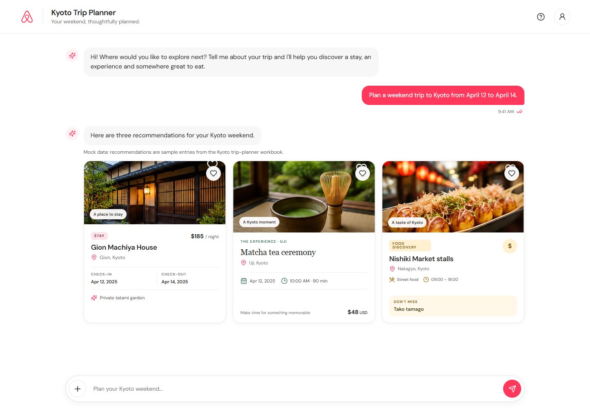

**Error state**

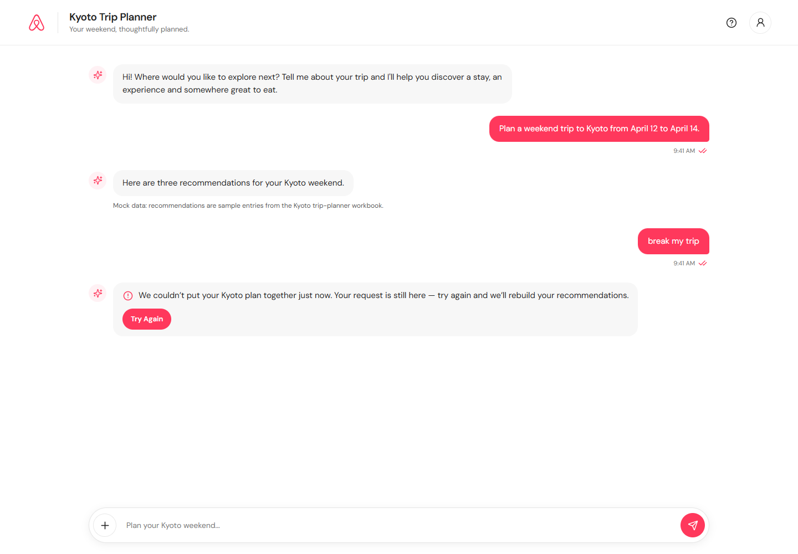

**Retry success**

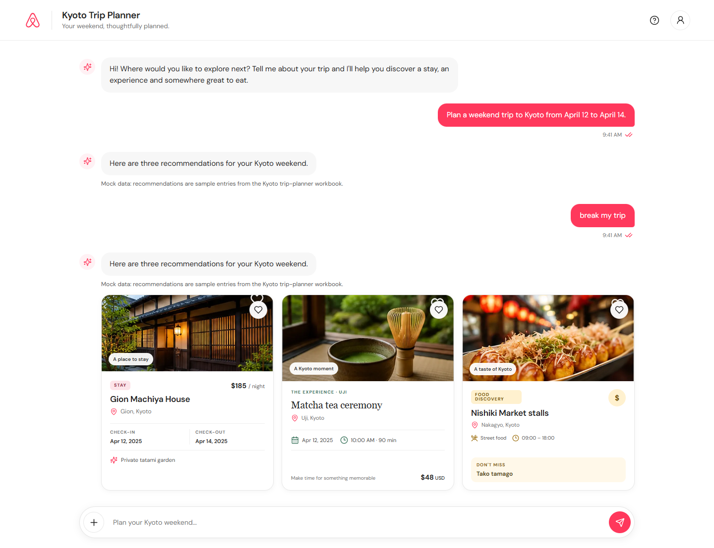

### Phone — 390 × 844

**Happy path**

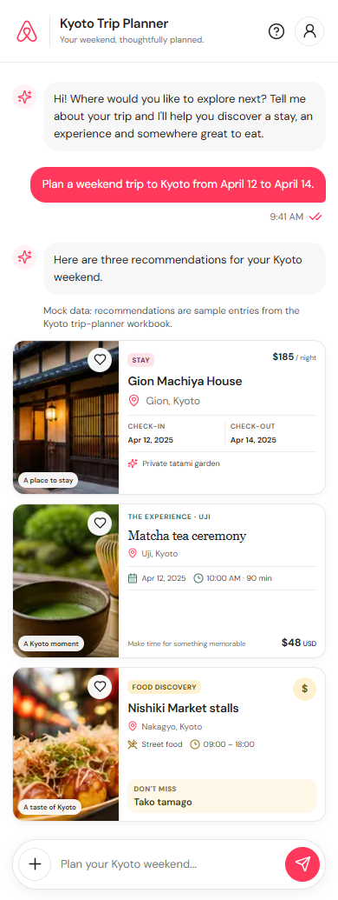

**Error state**

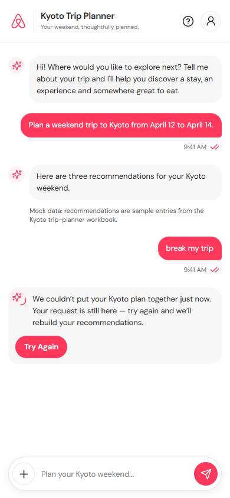

**Retry success**

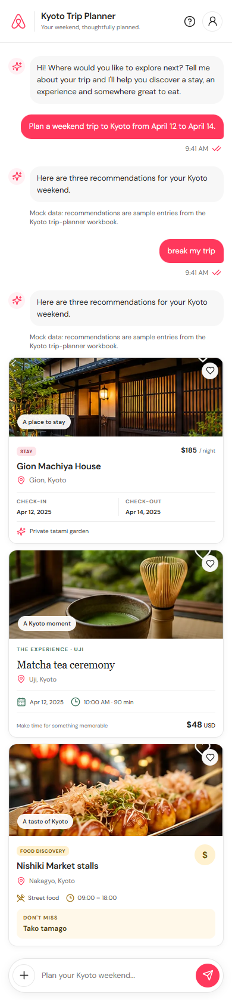

## Real Android Device Testing

These screenshots were captured on a physical Android phone, not a resized desktop viewport. The happy-path image shows all three recommendation cards, including the complete Food card above the fixed composer. The retry-success image shows the successful recommendation response; the thinking/loading screenshot is not used as retry-success evidence.

**Happy path**

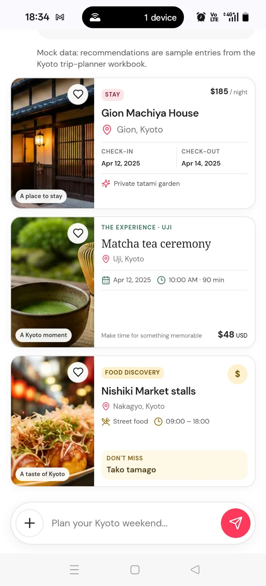

**Error state**

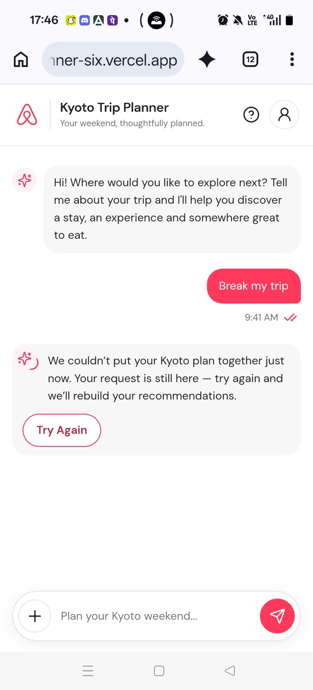

**Retry success**

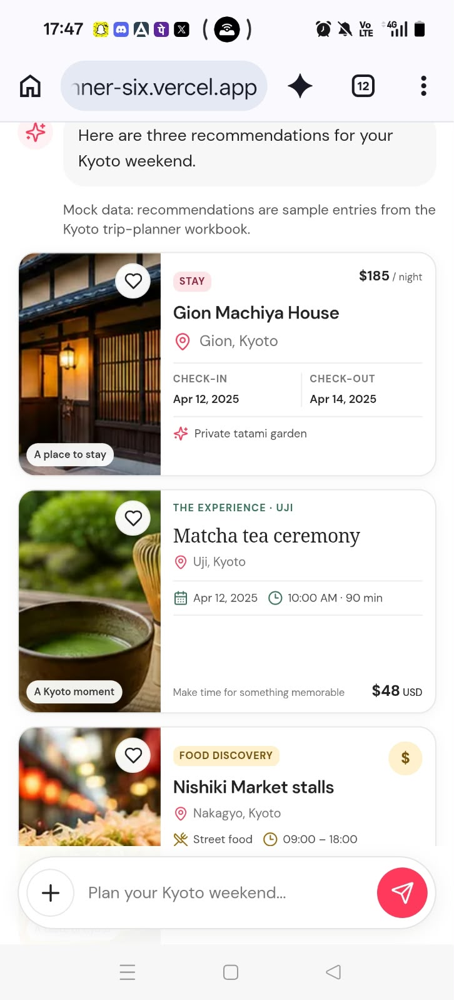

**Keyboard open**

The physical Android test confirmed that the composer remains visible with the keyboard open and that messaging and touch controls remain usable. The keyboard-open screenshot provides supporting visual evidence.

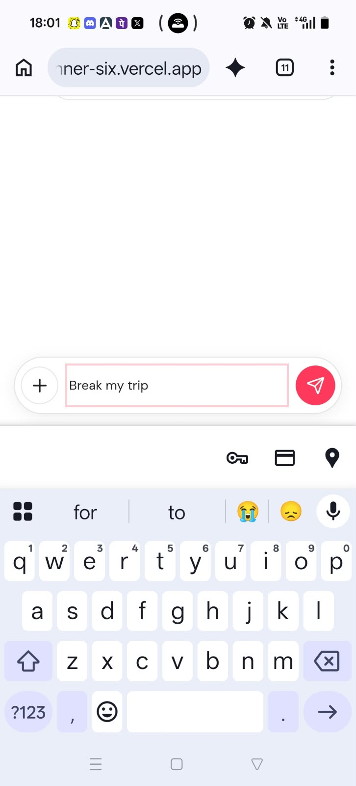

## Project Overview

The Kyoto Trip Planner explores a simpler alternative to traditional travel search filters. Guests can enter their trip requirements naturally and receive three recommendations together in one conversational response.

## Key Features

- Conversational trip-planning interface
- Animated thinking indicator
- Input locking while generating recommendations
- Three recommendation cards: Stay, Experience, and Food
- Responsive desktop and mobile layouts
- Workbook-based mock recommendation data
- Reusable React components
- Editable SVG icons
- Validated forced-failure and retry flow

## Recommendation Cards

### 1. Stay

**Gion Machiya House**

- **Location:** Gion, Kyoto
- **Check-in:** April 12, 2025
- **Check-out:** April 14, 2025
- **Price:** $185 per night
- **Highlight:** Private tatami garden

### 2. Experience

**Matcha Tea Ceremony**

- **Location:** Uji
- **Date:** April 12, 2025
- **Time:** 10:00 AM
- **Duration:** 90 minutes
- **Price:** $48 USD

### 3. Food

**Nishiki Market Stalls**

- **Location:** Nakagyo, Kyoto
- **Cuisine:** Street food
- **Price range:** $
- **Opening hours:** 09:00–18:00
- **Must-order:** Tako tamago

## Application States

### 01. Thinking State

After the guest submits a trip request, the message input temporarily locks while an animated thinking indicator appears in the assistant reply bubble.

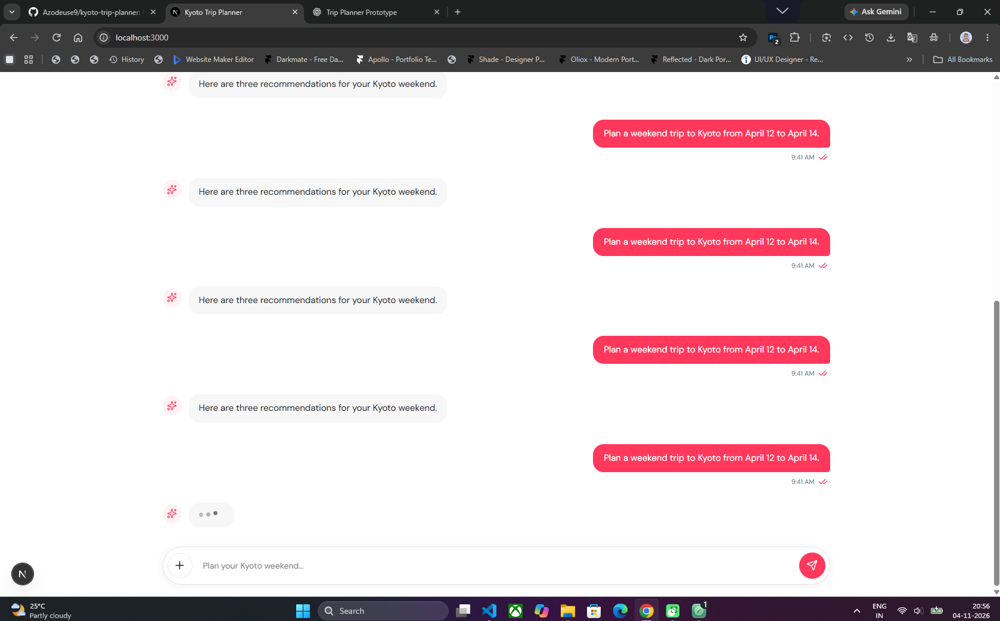

### 02. Error State

Type `break my trip` in the chat to simulate a failed trip-planning response. The trigger is trimmed and compared without regard to letter casing, so `BREAK MY TRIP` and ` Break My Trip ` trigger the same error.

The mock response in `data/mockBrokenResponse.ts` is intentionally incomplete and fails runtime validation in `utils/validateRecommendationResponse.ts` before it can reach the recommendation cards. The friendly error is shown inline in the assistant conversation; no technical error codes, alerts, or pop-ups are shown.

> We couldn’t put your Kyoto plan together just now. Your request is still here — try again and we’ll rebuild your recommendations.

The **Try Again** button retries the original request in the same conversation turn, bypasses the forced broken response, and restores the three valid workbook-backed recommendation cards. The original user message is not duplicated.

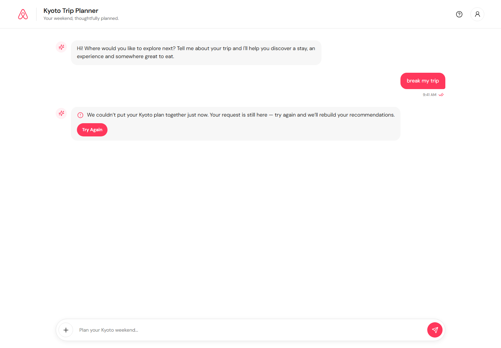

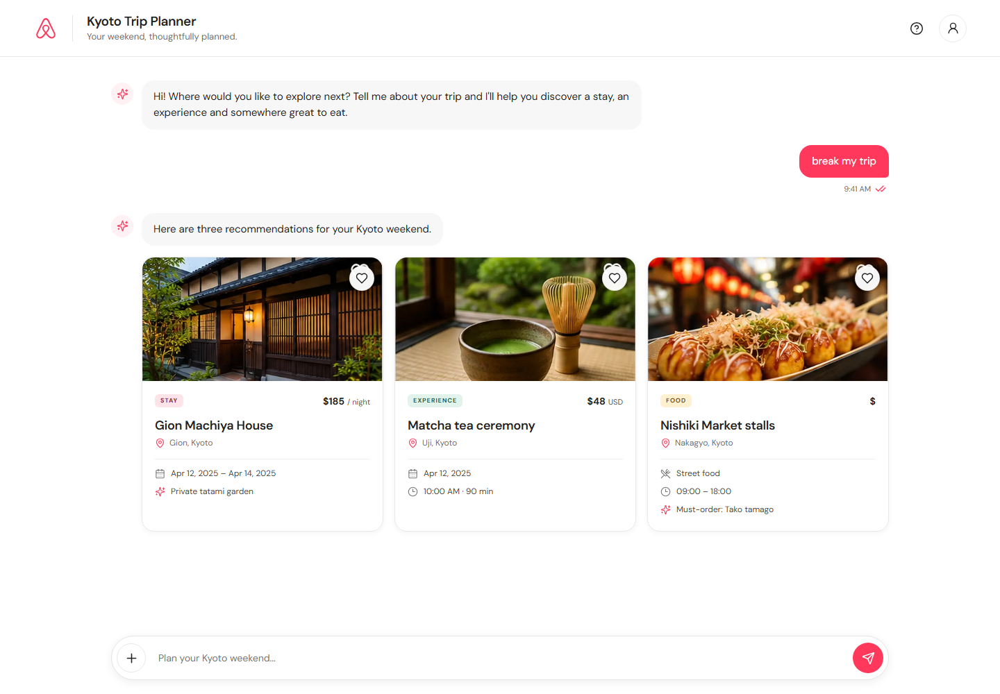

### 03. Cards State

After a successful request or retry, the planner displays all three recommendations together in this order:

1. **Stay**
2. **Experience**
3. **Food**

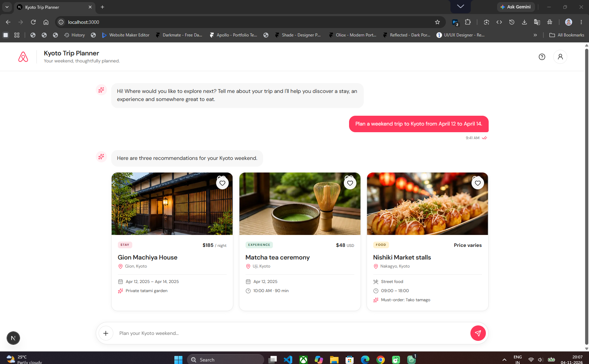

## Technology Stack

- Next.js
- React
- TypeScript
- Tailwind CSS
- Lucide React
- SVG icons

## Getting Started

Clone the repository:

```bash
git clone https://github.com/Azodeuse9/kyoto-trip-planner.git
cd kyoto-trip-planner
npm install
```

Start the development server:

```bash
npm run dev
```

Open [http://localhost:3000](http://localhost:3000) in your browser.

## Example Trip Requests

The chat includes these clickable example trip requests:

1. "Plan a weekend trip to Kyoto from April 12 to April 14."
2. "I want a traditional stay in Gion, a cultural tea experience and local street food."
3. "Help me plan a two-day Kyoto getaway with somewhere to stay, an activity and somewhere to eat."

Each normal request returns the same workbook-backed mock response with Stay, Experience, and Food recommendations. Type `break my trip` to test the inline error and **Try Again** recovery flow.

## Happy-Path Preview


## Local Development

From the project directory, run:

```bash
npm install
npm run dev
```

Then open [http://localhost:3000](http://localhost:3000).

## Project Structure

```text
kyoto-trip-planner/
├── app/
├── components/
├── data/
├── icons/
├── images/
├── public/
├── screenshots/
├── types/
├── utils/
├── README.md
└── package.json
```

## Data Source

Recommendations are workbook-backed mock data, using one sample response item from each worksheet: Stays, Experiences, and Food. They are illustrative and do not represent live availability or bookings.

## Project Status

Happy-path prototype development and visual refinement.
