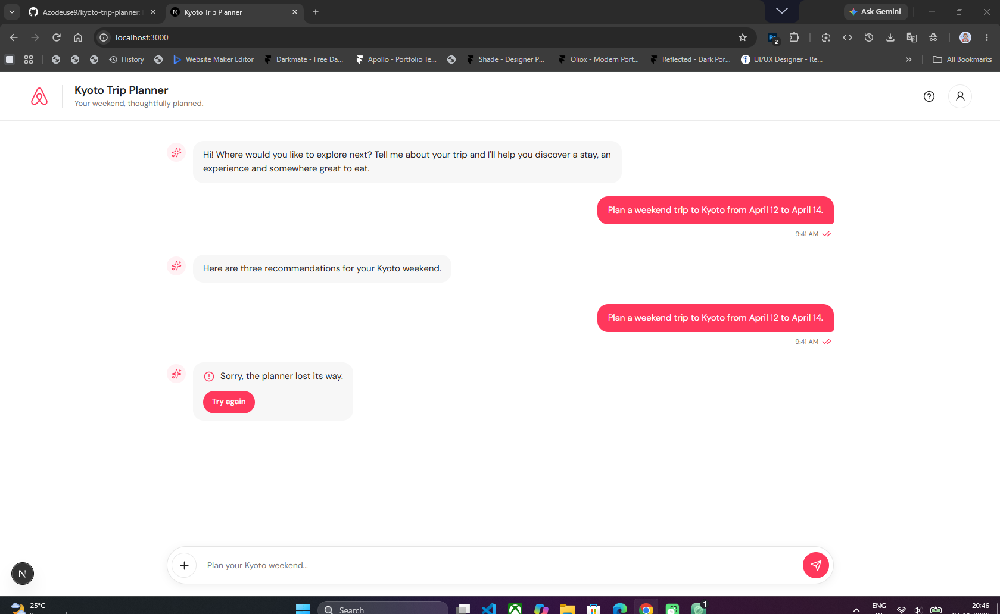

# Kyoto Trip Planner

An Airbnb-inspired conversational trip planner that helps guests discover a stay, an experience and food recommendations for a Kyoto weekend through a single chat request.

## Project Overview

The Kyoto Trip Planner explores a simpler alternative to traditional travel search filters. Guests can enter their trip requirements naturally and receive three recommendations together in one conversational response.

## Key Features

- Conversational trip-planning interface
- Animated thinking indicator
- Input locking while generating recommendations
- Three recommendation cards: Stay, Experience and Food
- Responsive desktop and mobile layouts
- Workbook-based mock recommendation data
- Reusable React components
- Editable SVG icons

## Recommendation Cards

### 1. Stay
**Gion Machiya House**

- Location: Gion, Kyoto
- Check-in: April 12, 2025
- Check-out: April 14, 2025
- Price: $185 per night
- Highlight: Private tatami garden

### 2. Experience
**Matcha Tea Ceremony**

- Location: Uji
- Date: April 12, 2025
- Time: 10:00 AM
- Duration: 90 minutes
- Price: $48 USD

### 3. Food
**Nishiki Market Stalls**

- Location: Nakagyo, Kyoto
- Cuisine: Street food
- Price range: $
- Opening hours: 09:00–18:00
- Must-order: Tako tamago

## Application States

### 01. Thinking State

After the guest submits a trip request, the message input temporarily locks while an animated thinking indicator appears in the assistant reply bubble.


### 02. Error State

Typing the exact phrase `break my trip` deliberately triggers a friendly failure:

> "Sorry, the planner lost its way."

The **Try again** button retries the original request, which remains visible in the conversation.



### 03. Cards State

After the guest selects **Try again**, the planner processes the original request and successfully displays three recommendations together:

- Stay
- Experience
- Food


## Technology Stack

- Next.js
- React
- TypeScript
- Tailwind CSS
- Lucide React
- SVG icons

## Getting Started

Clone the repository:

```bash
git clone https://github.com/Azodeuse9/kyoto-trip-planner.git
```

Navigate into the project:

```bash
cd kyoto-trip-planner
```

Install dependencies:

```bash
npm install
```

Start the development server:

```bash
npm run dev
```

Open http://localhost:3000 in your browser.

## Project Structure

```text
kyoto-trip-planner/
├── app/
├── components/
├── data/
├── icons/
├── images/
├── public/
├── screenshots/
├── types/
├── README.md
└── package.json
```

## Data Source

The recommendation content is based on the Kyoto weekend workbook, using one mock response item from each worksheet: Stays, Experiences and Food.

## Project Status

Happy-path prototype development and visual refinement.